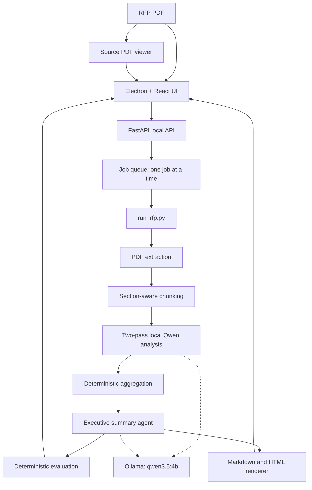

# Klaro Project Guide

This document explains Klaro as both a software system and a presentation narrative. It covers what each meaningful source file does, how an RFP moves through the system, which files are produced, and the technical decisions behind the pipeline.

## 1. Klaro in One Sentence

Klaro is a privacy-preserving desktop application that reads a text-based RFP PDF, uses a local Qwen3.5-4B model through Ollama to extract and summarize facts, preserves source-page references, evaluates the result, and presents the summary beside the original PDF.

The important privacy boundary is local-only execution:

```text
Electron UI -> 127.0.0.1 FastAPI -> local Python pipeline -> 127.0.0.1 Ollama
```

No RFP is sent to a cloud API by the implemented workflow.

## 2. High-Level Architecture



There are two ways to run the same core pipeline:

1. **CLI mode:** call `python -m backend.workflow.run_rfp <pdf>` directly.
2. **Desktop mode:** upload a PDF in Electron. FastAPI saves it, starts the same CLI as a child process, and streams progress to the React UI.

The desktop app is therefore a presentation and job-management layer around the reproducible CLI, not a second implementation of the analysis logic.

## 3. End-to-End Workflow

The canonical orchestrator is `backend/workflow/run_rfp.py`. It creates a unique run directory, copies the input PDF, calculates a SHA-256 hash, executes seven stages, records timings, and returns exit code `0` or `1`.

| Stage | What happens | Main implementation | Output |
| --- | --- | --- | --- |
| 1. PDF extraction | `pypdf` reads each page and extracts text. | `backend/documents/pdf_extractor.py` | `extracted/<name>.json` |
| 2. Chunking | Text is split into approximately 1,800-word overlapping chunks with detected section names and page numbers. | `backend/documents/chunker.py` | `chunks/<name>.json` |
| 3. Chunk analysis | Every chunk goes through Pass A for factual/structural facts and Pass B for commercial/contractual facts. | `chunk_analyzer.py`, `factual_analyzer.py`, `contractual_analyzer.py` | `extraction/executive_summary_chunks_v5_3.json` |
| 4. Aggregation | Chunk facts are merged, normalized, deduplicated, and given document-level page lists. Issuer identification is deterministic. | `backend/llm/executive_summary/aggregator.py` | `aggregation/executive_summary_aggregated_v1.json` |
| 5. Summary agent | Qwen turns the aggregated facts into a concise nine-field executive summary. | `backend/llm/executive_summary/agent.py` | `summary/executive_summary.json` |
| 6. Evaluation | The summary is checked for structure, grounding, traceability, coverage, duplication, category consistency, information loss, unsupported claims, and compression. | `backend/evaluation/evaluate_summary.py` | `evaluation/baseline_summary_evaluation.json/.md` |
| 7. Rendering | The summary JSON is converted into readable Markdown and self-contained HTML. | `backend/llm/executive_summary/render_summary.py` | `summary/executive_summary.md/.html` |

### Stage 1: Page-preserving extraction

`pdf_extractor.py` returns records shaped like:

```json
{"page": 1, "text": "Text extracted from page 1..."}
```

Page boundaries are kept from the beginning because the final product needs clickable evidence, not only an untraceable paragraph. Scanned or image-only PDFs are not supported because `pypdf` cannot produce usable text from them.

### Stage 2: Section-aware chunking

`chunker.py` uses `TARGET_WORDS = 1800` and `OVERLAP_WORDS = 200`. It detects strong numbered headings and `SECTION X:` headings, ignores likely table-of-contents pages, and attaches the current section plus page list to every chunk.

The overlap reduces the chance that a fact split across a chunk boundary disappears. The section label gives the model structural context without requiring the entire RFP in one prompt.

### Stage 3: Two-pass extraction

Each chunk is reconstructed with explicit page markers such as `[PAGE 31]` before it is sent to the model.

- **Pass A:** overview, scope, requirements, and eligibility.
- **Pass B:** dates, commercial requirements, project duration, and important conditions.

The two passes separate different reasoning tasks and keep prompts smaller. `chunk_analyzer.py` validates model responses with Pydantic models, merges the passes, removes exact duplicates within a chunk, records inference times, and reports progress.

If a minority of chunks fail, their failure is recorded and processing continues. If more than half fail, the stage raises an error because the document-level summary would be unreliable.

### Stage 4: Deterministic document aggregation

`aggregator.py` combines all chunk facts. It normalizes case, punctuation, and whitespace to identify duplicates, keeps the most detailed wording where near-identical text differs, and merges all source pages into a sorted unique list.

The issuing organization is also derived without an LLM: capitalized organization-like names are counted across overview facts, and the most frequently named organization wins. This is useful as a deterministic fallback, but it is a heuristic rather than a perfect named-entity recognizer.

### Stage 5: Grounded synthesis

`agent.py` sends only the aggregated JSON to Qwen. The prompt requires JSON-only output, preserves RFP terminology, and requires every list item to contain `text` and `pages`.

The code then validates and repairs predictable omissions:

- empty issuer values fall back to the aggregator's issuer;
- an empty overview can be synthesized from the first overview facts;
- an empty category can be populated from its aggregated input facts;
- the final object is validated against `ExecutiveSummaryOutput`.

This is a constrained synthesis step, not a free-form chatbot response.

### Stage 6: Evaluation

The evaluator compares the final summary to the aggregated evidence. Its checks are deterministic and do not ask another LLM to grade the answer. The result is both machine-readable JSON and a human-readable Markdown report.

The baseline has important scope limits: it is currently a single-document baseline, and lexical overlap is an approximation of factual grounding. A high score means the generated summary aligns with the available extracted evidence; it is not a proof of semantic correctness.

### Stage 7: Presentation

`render_summary.py` does not invent or alter facts. It formats the validated JSON into Markdown and escaped HTML, adds page tags, and displays an explicit empty-state message for missing categories.

## 4. Run Artifacts

Every completed run is self-contained:

```text
data/runs/<run_id>/
├── input/<original-file>.pdf
├── extracted/<original-file>.json
├── chunks/<original-file>.json
├── extraction/executive_summary_chunks_v5_3.json
├── aggregation/executive_summary_aggregated_v1.json
├── summary/
│   ├── executive_summary.json
│   ├── executive_summary.md
│   └── executive_summary.html
├── evaluation/
│   ├── baseline_summary_evaluation.json
│   └── baseline_summary_evaluation.md
├── pipeline.log                 # desktop/API runs
└── run_metadata.json
```

`run_metadata.json` contains the run ID, source path, copied input path, SHA-256 hash, model tag, inference mode, timestamp, status, per-stage timing, page/chunk counts, and evaluation scores. Failed runs also record the failing stage and error.

## 5. Summary Data Contract

The final `summary/executive_summary.json` has nine user-facing categories:

```json
{
  "overview": {"text": "...", "pages": [9, 30]},
  "issuing_organization": "...",
  "issuing_organization_pages": [9, 30],
  "scope": [{"text": "...", "pages": [30, 34]}],
  "key_requirements": [{"text": "...", "pages": [84]}],
  "eligibility": [{"text": "...", "pages": [83]}],
  "important_dates": [{"text": "...", "pages": [31]}],
  "commercial_requirements": [{"text": "...", "pages": [45]}],
  "project_duration": [],
  "important_conditions": [{"text": "...", "pages": [56]}]
}
```

The central technical property is traceability: a summary claim carries the page numbers that support it. In the UI, selecting a page tag changes the source PDF viewer to that page.

## 6. File-by-File Guide

### Root files

- `README.md`: project overview, architecture diagram, setup, canonical schemas, security warning, and next milestones.
- `requirements.txt`: Python dependencies for PDF parsing, FastAPI/Uvicorn, Ollama, Pydantic, and testing.
- `KLARO_PROJECT_GUIDE.md`: this presentation-oriented technical guide.

### Backend configuration and API

- `backend/config.py`: single source of truth for version, model tag, Ollama URL, data directory, LLM timeout, host, and port. It also performs the Ollama/model preflight check and creates the shared Ollama client.
- `backend/api/__main__.py`: binds an available local socket first, prints `KLARO_PORT=<n>` for Electron, then starts Uvicorn with that socket.
- `backend/api/app.py`: FastAPI application, CORS policy, lifecycle hooks, health endpoint, upload validation, run/status endpoints, artifact serving, summary embedding, source PDF serving, evaluation serving, and delete/cancel endpoint.
- `backend/api/jobs.py`: in-memory queue and job state. It accepts uploads, runs one pipeline process at a time, parses JSON progress events, measures stage/chunk timing, stores `pipeline.log`, supports cancellation, and reconstructs completed runs from disk.
- `backend/api/summary_embed.js`: browser script injected only for `summary.html?embed=1`; it makes page tags clickable and communicates page selections to the React results view.

### Document processing

- `backend/documents/pdf_extractor.py`: page-by-page `pypdf` text extraction and standalone batch utility for `data/rfp/*.pdf`.
- `backend/documents/chunker.py`: heading detection, table-of-contents filtering, section tracking, fixed-size chunking, overlap, and standalone chunk export.
- `backend/documents/document_stats.py`: standalone character, word, page, and rough token statistics. Its token estimate is `characters / 4`, not the actual Qwen tokenizer.

### LLM and summary pipeline

- `backend/llm/executive_summary/schema.py`: Pydantic contracts for extracted items, Pass A/Pass B output, chunk results, aggregated items, final summaries, and document analysis.
- `backend/llm/executive_summary/prompts.py`: system and user prompt templates for Pass A, Pass B, and final executive-summary synthesis.
- `backend/llm/executive_summary/factual_analyzer.py`: calls the local model for Pass A and parses factual/structural categories.
- `backend/llm/executive_summary/contractual_analyzer.py`: calls the local model for Pass B and parses commercial/contractual categories.
- `backend/llm/executive_summary/chunk_analyzer.py`: loads chunks, restores page-labeled text, runs both passes sequentially, merges/deduplicates results, applies failure tolerance, emits progress, and writes the document analysis JSON.
- `backend/llm/executive_summary/aggregator.py`: merges facts across chunks, deduplicates normalized text, combines pages, and deterministically derives the issuing organization.
- `backend/llm/executive_summary/agent.py`: sends aggregated facts to Qwen, parses/validates the final summary, applies deterministic fallbacks, and writes summary JSON.
- `backend/llm/executive_summary/render_summary.py`: converts summary JSON into Markdown and escaped self-contained HTML without changing content.
- `backend/llm/baseline_analyzer.py`: earlier standalone single-chunk requirements extractor. It is useful for experiments and debugging but is not the canonical seven-stage workflow.
- `backend/llm/executive_summary_baseline.py`: earlier standalone executive-summary experiment for a hard-coded chunk/file pair. It is also superseded by the workflow orchestrator.
- `backend/llm/run_baseline.py`: baseline runner entry point for the earlier experiment path.

### Workflow and evaluation

- `backend/workflow/run_rfp.py`: canonical end-to-end CLI, run-directory creation, seven-stage orchestration, progress event contract, metadata, and failure handling.
- `backend/workflow/rerun_summary.py`: creates a new run by reusing stages 1-3 and rerunning aggregation, synthesis, evaluation, and rendering. This avoids repeating the slow chunk-level model calls.
- `backend/evaluation/evaluate_summary.py`: deterministic nine-dimensional evaluation and JSON/Markdown report generation.
- `backend/evaluation/test_workflow.py`: validates input checks, hashing, mocked orchestration, artifacts, and metadata.
- `backend/evaluation/test_render_summary.py`: validates Markdown/HTML sections, page tags, empty fields, string compatibility, escaping, and file generation.
- `backend/evaluation/test_chunk_failures.py`: verifies that half-failed chunks are tolerated but more-than-half failure aborts analysis.
- `backend/evaluation/test_issuing_org.py`: verifies deterministic issuer extraction and normalization.

### Electron main process

- `electron/main.js`: starts the Python API, waits for the health endpoint, creates the secure BrowserWindow, restricts navigation/webviews, exposes file selection, and stops the backend when the app exits.
- `electron/preload.js`: the narrow context-isolated bridge. It exposes only API-base lookup, file opening, and validated external-link opening.
- `electron/scripts/dev.mjs`: starts the Vite server on a free port and launches Electron pointed at that renderer URL.
- `electron/vite.config.mjs`: Vite configuration for the React renderer.
- `electron/package.json`: Node/Electron scripts, runtime dependencies, development dependencies, and Node version requirement.
- `electron/README.md`: desktop setup, API contract, progress contract, data locations, environment settings, checks, and packaging status.

### Electron renderer

- `electron/renderer/index.html`: renderer HTML entry point.
- `electron/renderer/src/main.jsx`: React DOM bootstrap.
- `electron/renderer/src/App.jsx`: small screen state machine: setup, home, progress, and results.
- `electron/renderer/src/api.js`: HTTP client for the local FastAPI endpoints; all failed requests become user-facing errors.
- `electron/renderer/src/Setup.jsx`: checks Ollama and model availability and displays the required setup command.
- `electron/renderer/src/Home.jsx`: PDF selection/drop zone, run history, upload, and cancel/delete actions.
- `electron/renderer/src/Progress.jsx`: polls run status every second, displays seven-stage progress and chunk ETA, and allows cancellation.
- `electron/renderer/src/Results.jsx`: displays the embedded summary, source PDF webview, page navigation, and evaluation quality tab.
- `electron/renderer/src/TopBar.jsx`: shared application header.
- `electron/renderer/src/icons.jsx`: reusable UI icon components.
- `electron/renderer/src/format.js`: presentation formatting helpers for dates and durations.
- `electron/renderer/src/frameStyle.js`: renderer-side style payload used by the embedded summary frame.
- `electron/renderer/src/tokens.css`: design tokens, bundled fonts, and shared visual variables.
- `electron/renderer/src/styles.css`: application layout and component styles.
- `electron/renderer/src/summary-frame.css`: styles applied to the embedded generated summary.

## 7. Desktop Request Lifecycle

1. `Setup.jsx` calls `GET /health`. The user proceeds only when Ollama is reachable and the configured model is installed.
2. `Home.jsx` accepts a `.pdf` through the native file dialog or drag-and-drop and calls `POST /runs`.
3. `app.py` checks the filename and PDF magic bytes, then `jobs.py` saves the upload under `data/uploads/<run_id>/` and queues it.
4. The worker starts `python -m backend.workflow.run_rfp ... --progress-json` as a child process.
5. `run_rfp.py` writes machine-readable progress events to stdout; human-readable logs go to stderr and are saved as `pipeline.log`.
6. `Progress.jsx` polls `GET /runs/{id}` every second and renders the current stage and chunk progress.
7. When complete, `Results.jsx` loads the generated summary HTML, evaluation JSON, and source PDF from the API.
8. Clicking a page tag sends a validated message to the parent renderer, which reloads the locked-down PDF webview at the selected page.

The API deliberately runs one job at a time because the local model is the bottleneck and concurrent requests would compete for the same laptop resources.

## 8. Setup and Presentation Demo

From the repository root on Windows PowerShell:

```powershell
py -3.12 -m venv .venv
.venv\Scripts\pip install -r requirements.txt
ollama pull qwen3.5:4b
cd electron
npm install
npm run dev
```

Suggested presentation sequence:

1. Show the setup screen proving the model is local and available.
2. Drop a text-based RFP PDF on the home screen.
3. Explain the seven progress stages, especially the two-pass chunk analysis.
4. Open a generated summary and click a page citation.
5. Show the source PDF jumping to the cited page.
6. Open the Quality tab and explain grounding, traceability, coverage, duplication, and compression.
7. Show the run folder to demonstrate reproducibility and inspect `run_metadata.json`.

CLI-only demonstration:

```powershell
.venv\Scripts\python.exe -m backend.workflow.run_rfp data/rfp/1.pdf
```

To rerun the final stages without paying for new chunk-level model calls:

```powershell
.venv\Scripts\python.exe -m backend.workflow.rerun_summary data/runs/<run_id>
```

## 9. Testing and Technical Checks

Run the focused Python tests with:

```powershell
.venv\Scripts\python.exe -m unittest backend/evaluation/test_workflow.py backend/evaluation/test_render_summary.py backend/evaluation/test_chunk_failures.py backend/evaluation/test_issuing_org.py
```

The tests mock model calls where appropriate, so they validate orchestration and data behavior without requiring a long live Qwen run. A live end-to-end run additionally requires Ollama and the downloaded model.

## 10. Security, Reliability, and Known Limitations

- **Local data:** Electron communicates with `127.0.0.1`; Ollama also runs locally. Raw RFPs and extracted text should remain uncommitted. `data/rfp/`, `data/extracted/`, `data/chunks/`, and `data/runs/` are intended to be local data paths.
- **Renderer isolation:** Node integration is disabled, context isolation is enabled, navigation is blocked, external links are restricted to HTTPS, and the PDF webview only accepts the current run's source PDF route.
- **Input limitation:** scanned/image-only PDFs do not work because there is no OCR stage.
- **Model cost:** a 4B model on a laptop can take about a minute per model call. A 40-page document may take roughly 25-40 minutes because each chunk has two calls plus one final summary call.
- **Evaluation limitation:** the current baseline covers one RFP and uses lexical evidence matching. It should not be generalized as a benchmark for all RFPs.
- **Taxonomy leakage:** upstream extraction can place a fact in a neighboring category; deterministic later stages preserve that classification rather than silently changing the evidence.
- **Packaging status:** development mode is implemented. Packaged mode expects a future PyInstaller backend binary under `resources/klaro-backend/`; an electron-builder/PyInstaller release pipeline is not yet implemented.

## 11. Main Talking Points

For a short technical presentation, emphasize these design choices:

1. **Evidence first:** page numbers are preserved from PDF extraction through final rendering.
2. **Small-model strategy:** chunking and two specialized passes make a local 4B model useful on long RFPs.
3. **LLM plus deterministic code:** the model extracts and summarizes language; schemas, deduplication, aggregation, evaluation, and rendering provide control and repeatability.
4. **One canonical pipeline:** the desktop app invokes the same CLI used for experiments and direct runs.
5. **Reproducible artifacts:** every run stores its inputs, intermediate JSON, final reports, evaluation, timings, and hash.
6. **Honest quality measurement:** the evaluator exposes grounding, traceability, coverage, omissions, duplicates, and compression instead of returning only a vague confidence score.
